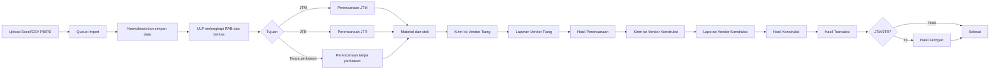
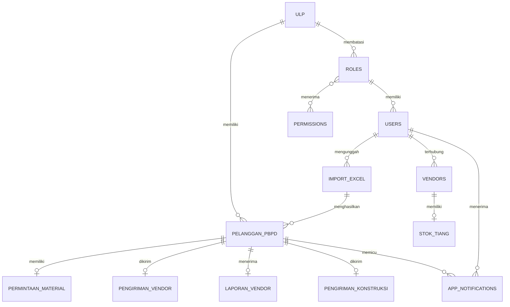

# FAST ON 360

## Sistem Informasi Pengelolaan PB/PD, Perluasan Jaringan, Vendor, dan Laporan

Dokumen ini merupakan dokumentasi teknis sekaligus bahan dasar laporan dan buku untuk proyek **FAST ON 360**. Aplikasi ini dibangun untuk membantu pengelolaan data pelanggan **Pasang Baru (PB)** dan **Perubahan Daya (PD)** dari tingkat ULP sampai proses perencanaan, vendor, konstruksi, transaksi, jaringan, dan pelaporan.

> README ini disusun berdasarkan analisis struktur kode, route, controller, model, migration, seeder, view, konfigurasi build, serta pengujian yang tersedia di repository.

## 1. Ringkasan Eksekutif

FAST ON 360 adalah aplikasi web berbasis Laravel yang memusatkan proses administrasi dan monitoring pekerjaan PB/PD. Data pelanggan dapat dimasukkan melalui file Excel atau CSV, diproses secara asinkron, dikaitkan dengan ULP, lalu dialirkan melalui tahapan kerja berdasarkan tujuan perluasan jaringan.

Sistem menggabungkan beberapa proses berikut:

- pengunggahan dan normalisasi data PB/PD;
- pengelolaan RAB dan material;
- pembagian pekerjaan ke vendor tiang dan vendor konstruksi;
- pengelolaan stok tiang per vendor;
- unggah berkas pekerjaan, laporan, hasil perencanaan, hasil konstruksi, transaksi, dan jaringan;
- notifikasi proses dan pengingat keterlambatan vendor;
- dashboard, filter laporan, dan ekspor laporan ke Excel;
- autentikasi berbasis akun aktif dan otorisasi berbasis role serta permission.

## 2. Tujuan Sistem

1. Menyediakan sumber data PB/PD yang terpusat.
2. Memperjelas tanggung jawab antar-ULP, unit UP3, dan vendor.
3. Mengurangi pencatatan manual pada pengiriman pekerjaan dan laporan.
4. Memudahkan pelacakan tahap dan kelengkapan berkas setiap agenda.
5. Menyediakan laporan yang dapat difilter dan diekspor.
6. Memberikan notifikasi perubahan proses dan keterlambatan vendor.

## 3. Ruang Lingkup Fungsional

### 3.1 Autentikasi dan akses

- Login menggunakan `user_id` dan password.
- Hanya akun aktif yang dapat masuk.
- Tidak tersedia route pendaftaran publik.
- Logout menghapus sesi dan meregenerasi token.
- Percobaan login dibatasi melalui rate limiter.
- Akses halaman dan aksi dibatasi oleh permission serta pemeriksaan role.
- Vendor hanya melihat agenda yang ditugaskan kepada vendor tersebut.

### 3.2 Dashboard

Dashboard menyajikan total data, data belum diproses, data dalam proses, data selesai, distribusi berdasarkan tahap/tujuan/jenis/ULP, serta aktivitas terbaru.

### 3.3 Data PB/PD

Halaman Data PB/PD digunakan untuk melihat dan mencari data pelanggan, memfilter berdasarkan jenis transaksi/status/tahap/ULP, melihat ringkasan, mengisi RAB, mengunggah berkas pendukung dan izin, serta mengirim data dari ULP ke tahap perencanaan.

Status permohonan yang menjadi fokus tampilan:

- `CETAK PK`;
- `BAYAR`;
- `PENGESAHAN PDL`;
- `PDL AWAL`.

Jenis transaksi utama pada laporan adalah `PASANG BARU` dan `PERUBAHAN DAYA`.

### 3.4 Impor Excel/CSV PB/PD

Fitur upload menerima `xlsx`, `xls`, atau `csv`. Proses impor berjalan melalui database queue.

Karakteristik proses:

- ukuran file maksimal 20 MB;
- CSV mendukung delimiter koma, titik koma, tab, dan pipe;
- header dicari pada 20 baris awal berdasarkan kolom yang mengandung kata agenda;
- mendukung header satu baris atau dua baris untuk kolom lama/baru;
- pemrosesan dilakukan per chunk 5.000 baris;
- pencarian data lama dilakukan secara batch;
- status proses: `queued`, `processing`, `completed`, atau `failed`;
- jumlah baru, diperbarui, dan gagal disimpan pada riwayat impor;
- file sementara dihapus setelah proses selesai atau gagal.

Kolom yang dipetakan antara lain nomor agenda, ID pelanggan, nama, alamat, ULP, tarif dan daya lama/baru, jenis transaksi, status, total biaya, tanggal permohonan, tanggal bayar, dan durasi pekerjaan.

### 3.5 Perluasan jaringan

| Tujuan | Keterangan |
|---|---|
| `JTM` | Perluasan jaringan tegangan menengah |
| `JTR` | Perluasan jaringan tegangan rendah |
| `TANPA_PERLUASAN` | Pekerjaan tanpa perluasan jaringan |

Kebutuhan material dapat mencakup tiang TM/TR, konduktor TM/TR, trafo, KWH meter, dan panel meter.

### 3.6 Vendor tiang dan stok

Modul vendor tiang mencakup agenda, WO, status kelayakan, laporan vendor, hasil perencanaan, riwayat, dan pembatasan data berdasarkan vendor yang login.

Stok dikelola per vendor sebagai:

- stok TR;
- stok TM total;
- stok TM 11;
- stok TM 13.

Sebelum pengiriman, aplikasi memeriksa ketersediaan stok. Pemakaian dicatat melalui transaksi database dan dikembalikan jika pengiriman dibatalkan sebelum laporan vendor masuk.

### 3.7 Vendor konstruksi

Modul ini mencakup agenda konstruksi, berkas pengiriman, laporan vendor, checklist kelengkapan pekerjaan, kesesuaian WO, foto, catatan, hasil perencanaan, hasil konstruksi, dan riwayat.

### 3.8 Transaksi, jaringan, notifikasi, dan laporan

Unit Transaksi dapat mengunggah hasil transaksi, sedangkan Unit Jaringan dapat mengunggah hasil jaringan. Notifikasi dibuat ketika data dikirim, laporan masuk, atau hasil pekerjaan diunggah. Tersedia command `vendor-tiang:check-deadlines` untuk mengingatkan laporan vendor yang terlambat.

Halaman laporan menyediakan filter nomor agenda, ULP, tahap, jenis transaksi, dan status, serta ekspor ke Excel.

## 4. Alur Bisnis Utama



### Tahap proses

| Nilai internal | Label proses | Makna |
|---|---|---|
| `ULP` | ULP | Data masih berada pada unit asal |
| `PERENCANAAN` | Perencanaan | Data diproses oleh Perencanaan |
| `VENDOR_TIANG` | Konstruksi (Tiang) | Menunggu atau diproses vendor tiang |
| `VENDOR_KONSTRUKSI` | Konstruksi | Diproses vendor konstruksi |
| `PENGOPERASIAN` | Transaksi | Masuk tahap transaksi/pengoperasian |
| `SELESAI` | Jaringan | Dokumen wajib telah lengkap |

Untuk JTM/JTR, hasil jaringan wajib tersedia. Penyelesaian juga memeriksa hasil perencanaan, hasil konstruksi, WO NPS, hasil transaksi, laporan vendor, dan laporan vendor konstruksi.

## 5. Aktor dan Hak Akses

Hak akses didefinisikan melalui `PermissionSeeder`, middleware `permission`, Gate Laravel, serta pemeriksaan role pada controller.

| Aktor | Tanggung jawab utama |
|---|---|
| ULP | Melihat data wilayah, mengisi RAB, mengunggah berkas persyaratan, dan mengirim data |
| NPS UP3 | Mengunggah berkas WO NPS |
| Manager UP3 | Monitoring dan laporan lintas ULP |
| Perencanaan | Mengelola material, stok, pengiriman vendor tiang, dan hasil perencanaan |
| Konstruksi | Mengirim pekerjaan ke vendor konstruksi dan mengunggah hasil konstruksi |
| Transaksi | Mengunggah hasil transaksi |
| Jaringan | Mengunggah hasil jaringan |
| Vendor tiang | Melihat agenda yang ditugaskan dan mengirim laporan |
| Vendor konstruksi | Melihat agenda yang ditugaskan dan mengirim laporan konstruksi |
| Administrator | Monitoring dan pengelolaan sesuai permission |

Permission utama meliputi:

```text
dashboard.view
pbpd.upload
pbpd.view
perluasan.jtm.view
perluasan.jtr.view
tanpa.perluasan.view
permintaan.create
perencanaan.process
konstruksi.process
pengoperasian.upload
jaringan.upload
vendor.tiang.view
vendor.tiang.process
vendor.tiang.history
stok.tiang.view
stok.tiang.manage
vendor.konstruksi.view
vendor.konstruksi.process
vendor.konstruksi.history
laporan.view
notifikasi.view
```

## 6. Arsitektur Teknis

### Teknologi

| Komponen | Teknologi |
|---|---|
| Backend | PHP 8.2+ |
| Framework | Laravel 12 |
| ORM | Eloquent |
| Frontend | Blade, Tailwind CSS, Vite |
| Build tool | Vite 6 |
| Spreadsheet | Maatwebsite Laravel Excel 3.1 |
| Queue | Laravel database queue |
| Testing | PHPUnit 11 |
| Storage | Laravel filesystem, disk local dan public |

### Pola aplikasi

```text
Browser
  -> routes/web.php
  -> middleware auth dan permission
  -> controller
  -> service/job/import/export
  -> model Eloquent
  -> database dan filesystem
```

Komponen penting:

- `routes/web.php`: route web, middleware, dan permission;
- `app/Http/Controllers`: alur request dan validasi bisnis;
- `app/Models`: model, relasi, casting, scope, dan aturan kelengkapan;
- `app/Services/NotifikasiService.php`: pembuatan notifikasi;
- `app/Jobs/ProcessPbpdImport.php`: queue job impor;
- `app/Imports/PelangganPbpdImport.php`: normalisasi Excel/CSV;
- `app/Exports/LaporanExport.php`: ekspor laporan;
- `app/Console/Commands/CheckVendorTiangDeadlines.php`: pengingat deadline;
- `resources/views`: antarmuka Blade;
- `database/migrations`: evolusi database;
- `database/seeders`: data awal aplikasi.

## 7. Struktur Direktori

```text
app/
├── Console/Commands/       # Command dan pengecekan deadline
├── Exports/                # Export laporan ke Excel
├── Http/Controllers/       # Controller fitur aplikasi
├── Http/Middleware/        # Pemeriksaan permission
├── Imports/                # Import Excel/CSV
├── Jobs/                   # Queue job
├── Models/                 # Model Eloquent
├── Providers/              # Konfigurasi service dan Gate
└── Services/               # Service lintas fitur

bootstrap/                 # Bootstrap Laravel
config/                    # Konfigurasi aplikasi
database/
├── factories/              # Factory pengujian
├── migrations/             # Skema database
└── seeders/                # Data awal
public/                    # Entry point dan aset publik
resources/
├── css/                    # CSS aplikasi
├── js/                     # JavaScript
└── views/                  # Blade template
routes/                    # Route web dan console
tests/                     # Unit test dan feature test
report_assets/             # Screenshot dokumentasi internal
```

Folder `vendor` dan `node_modules` adalah dependency hasil instalasi. Folder `strix_runs` dan file laporan `.docx` merupakan artefak pendukung/internal, bukan runtime inti aplikasi.

## 8. Model Data Utama



| Tabel | Fungsi |
|---|---|
| `users` | Akun pengguna dan status aktif |
| `roles` | Role, tipe unit, dan kode role |
| `permissions` | Daftar kemampuan aplikasi |
| `permission_role` | Relasi role dan permission |
| `ulp` | Referensi unit layanan pelanggan |
| `vendors` | Vendor tiang dan konstruksi |
| `import_excel` | Riwayat dan status impor |
| `pelanggan_pbpd` | Data utama pelanggan dan tahap |
| `permintaan_material` | Kebutuhan material |
| `stok_tiang` | Stok tiang per vendor |
| `pengiriman_vendor` | Pengiriman agenda dan WO vendor tiang |
| `laporan_vendor` | Laporan vendor tiang dan hasil perencanaan |
| `pengiriman_konstruksi` | Pengiriman, laporan, dan hasil konstruksi |
| `app_notifications` | Notifikasi pengguna |
| `jobs`, `cache` | Infrastruktur queue dan cache Laravel |

Path berkas disimpan pada kolom JSON dan nama berkas asli pada kolom pasangan `*_names` jika tersedia. Isi berkas berada di filesystem Laravel.

## 9. Route Utama

| Area | Route | Fungsi |
|---|---|---|
| Auth | `/login`, `/logout` | Masuk dan keluar |
| Dashboard | `/dashboard` | Ringkasan proses |
| Data PB/PD | `/pbpd` | Daftar dan detail pelanggan |
| Upload | `/pbpd-upload` | Upload dan riwayat impor |
| Perluasan JTM | `/perluasan/jtm` | Proses JTM |
| Perluasan JTR | `/perluasan/jtr` | Proses JTR |
| Tanpa perluasan | `/tanpa/perluasan` | Proses tanpa perluasan |
| Vendor tiang | `/vendor/tiang` | Agenda dan laporan vendor tiang |
| Stok tiang | `/stok-tiang` | Stok per vendor |
| Vendor konstruksi | `/vendor/konstruksi` | Agenda dan laporan konstruksi |
| Laporan | `/laporan` | Monitoring dan ekspor |
| Notifikasi | `/notifikasi` | Daftar dan pembacaan notifikasi |

## 10. Penanganan Berkas

Jenis berkas proses yang divalidasi:

```text
pdf, doc, docx, xls, xlsx, jpg, jpeg, png
```

Batas umum berkas proses adalah 10 MB per file. Berkas impor Excel/CSV memiliki batas 20 MB per file.

Direktori penyimpanan logis:

- `pbpd-imports`: file impor sementara;
- `wo-tiang`: WO vendor tiang;
- `pengiriman-konstruksi`: berkas pengiriman konstruksi;
- `laporan-vendor` dan `laporan-konstruksi`: laporan vendor;
- `hasil-perencanaan` dan `hasil-konstruksi`: hasil pekerjaan;
- `nps/wo`, `hasil-transaksi`, `hasil-jaringan`, dan `syarat/*`: dokumen proses lainnya.

Berkas diakses melalui controller dan `publicFileResponse`, bukan dengan menampilkan path filesystem secara langsung.

## 11. Keamanan

Implementasi yang terlihat pada source code:

- password disimpan menggunakan hashing Laravel;
- session diregenerasi setelah login;
- login dibatasi rate limiter;
- route dilindungi middleware `auth`;
- menu dan aksi memakai permission;
- pemeriksaan role dilakukan kembali pada aksi penting;
- data vendor dibatasi berdasarkan user vendor;
- tipe dan ukuran file divalidasi;
- form memakai CSRF token;
- perubahan stok dan pengiriman memakai transaksi database;
- URL notifikasi dinormalisasi ke path lokal;
- file lama dihapus saat penggantian atau pembatalan tertentu.

Sebelum publikasi atau deployment:

- jangan commit `.env`, kredensial, API key, token, private key, atau password produksi;
- jangan memasukkan data pelanggan dan dokumen operasional nyata ke README;
- ganti seluruh kredensial hasil seeder sebelum production;
- gunakan HTTPS;
- batasi akses storage dan log;
- audit otorisasi setiap endpoint pembacaan file;
- simpan artefak security testing dan laporan internal di lokasi privat.

## 12. Instalasi Pengembangan

Prasyarat: PHP 8.2+, Composer, Node.js/npm, database yang sesuai dengan query aplikasi, serta ekstensi PHP Laravel dan Laravel Excel.

Perintah umum di Windows PowerShell:

```powershell
composer install
npm install
Copy-Item .env.example .env
php artisan key:generate
```

Isi nilai konfigurasi lokal pada `.env` sesuai database, filesystem, queue, dan mail server. Nilai rahasia sengaja tidak ditulis pada dokumentasi ini.

Jalankan migration, seeder, build, dan storage:

```powershell
php artisan migrate --seed
npm run build
php artisan storage:link
```

Jalankan layanan development:

```powershell
php artisan serve
php artisan queue:work --tries=1
php artisan schedule:work
```

Atau gunakan script Composer:

```powershell
composer run dev
```

## 13. Database, Queue, dan Scheduler

Template environment mendukung SQLite, MySQL/MariaDB, PostgreSQL, dan SQL Server. Namun, source code saat ini menggunakan ekspresi PostgreSQL seperti `ILIKE`, `jsonb_array_length`, dan casting `jsonb` pada filter laporan. PostgreSQL adalah pilihan paling aman tanpa modifikasi query. Jika menggunakan SQLite atau MySQL, query tersebut perlu diabstraksikan per driver.

Import PB/PD membutuhkan worker queue:

```powershell
php artisan queue:work --tries=1
```

Scheduler mendaftarkan:

```text
vendor-tiang:check-deadlines
```

Pada production, gunakan supervisor/service manager untuk queue dan scheduler. Nilai batas waktu vendor saat ini masih berada di konfigurasi service; sebaiknya dipindahkan ke environment variable sebelum production.

Checklist operasional:

1. migration sudah berjalan;
2. seeder dipakai sesuai kebutuhan lingkungan;
3. queue worker aktif;
4. scheduler aktif;
5. storage dapat ditulis;
6. log dan failed jobs dipantau;
7. backup database dan storage berjalan;
8. akun hasil instalasi diganti atau dinonaktifkan.

## 14. Pengujian

Perintah pengujian:

```powershell
php artisan test
```

Test yang tersedia saat ini masih berupa test dasar Laravel:

- feature test untuk memastikan `/` mengarah ke dashboard;
- unit test sederhana untuk assertion dasar.

Test domain yang disarankan:

- login akun aktif dan penolakan akun tidak aktif;
- rate limit login;
- permission setiap role;
- pembatasan data antar-ULP dan antar-vendor;
- import Excel/CSV, duplikasi, normalisasi, dan baris gagal;
- validasi upload dan pembacaan file;
- transaksi stok saat pengiriman dibuat/diubah/dibatalkan;
- notifikasi dan deadline;
- ekspor laporan;
- penyelesaian otomatis saat dokumen wajib lengkap.

## 15. Catatan Teknis dan Rekomendasi

### 15.1 Kompatibilitas database

Template environment mengarah ke SQLite secara default, sedangkan beberapa controller memakai SQL PostgreSQL. Tetapkan database target dengan jelas atau buat query portable.

### 15.2 Migration sesi

Konfigurasi template memakai database session, tetapi daftar migration tidak menunjukkan migration khusus tabel `sessions`. Jika memakai `SESSION_DRIVER=database`, pastikan tabel tersebut dibuat. Untuk development sederhana, session file dapat digunakan.

### 15.3 Menu placeholder

Menu `Pengoperasian` dan `Pencarian` masih mengarah ke view generik `halaman.blade.php`. Fitur tersebut perlu controller, query, permission, dan test jika akan dianggap selesai.

### 15.4 Artefak bawaan Laravel

`resources/views/welcome.blade.php` masih memuat tampilan bawaan Laravel dan referensi pendaftaran, sedangkan route register publik tidak tersedia. Halaman ini sebaiknya disesuaikan atau diarahkan ke login.

### 15.5 Riwayat tahap

Model mencatat tahap terkini pada `pelanggan_pbpd`, tetapi belum terdapat tabel histori perpindahan tahap. Untuk audit, tambahkan histori tahap lama, tahap baru, user, waktu, dan catatan.

### 15.6 Model legacy

Model `PelangganPbpd` masih memiliki relasi ke class legacy yang tidak terlihat pada struktur `app/Models` saat ini, seperti data perencanaan, data konstruksi, checklist, dan berkas umum. Relasi tersebut perlu dilengkapi atau dihapus jika tidak digunakan.

### 15.7 Seeder dan kredensial awal

Seeder membuat akun awal untuk role aplikasi. Kredensial awal tidak boleh dipakai di production dan tidak boleh dicantumkan di README. Tambahkan mekanisme ganti password atau nonaktifkan akun demo.

### 15.8 Konsistensi otorisasi berkas

Uji setiap endpoint file untuk kombinasi role, ULP, vendor, dan ID pelanggan. Setiap endpoint sebaiknya memeriksa autentikasi, permission, kepemilikan data, dan konteks unit.

## 16. Bahan Laporan atau Buku

README ini dapat dikembangkan menjadi bab:

1. **Pendahuluan** — latar belakang proses PB/PD dan masalah administrasi manual;
2. **Analisis kebutuhan** — aktor, alur kerja, kebutuhan fungsional, dan nonfungsional;
3. **Perancangan sistem** — arsitektur Laravel, use case, flowchart, ERD, dan hak akses;
4. **Implementasi** — impor, dashboard, perluasan, vendor, stok, notifikasi, laporan, dan ekspor;
5. **Keamanan** — autentikasi, permission, upload, CSRF, rate limit, dan pembatasan data;
6. **Pengujian** — skenario uji dan hasil pengujian;
7. **Evaluasi** — database, placeholder, coverage test, dan histori proses;
8. **Kesimpulan dan pengembangan** — manfaat dan roadmap.

Screenshot pada `report_assets` dapat digunakan sebagai ilustrasi internal setelah dipastikan tidak menampilkan data pelanggan, alamat, kredensial, atau informasi operasional yang tidak boleh dipublikasikan.

## 17. Perlindungan Informasi Sensitif

README ini tidak memuat:

- file `.env` atau isi variabel environment;
- password, API key, token, private key, atau kredensial database;
- data pelanggan nyata;
- isi dokumen upload;
- isi laporan security testing internal.

File `.env.example` hanya berfungsi sebagai template konfigurasi. Gunakan `.env` lokal untuk nilai rahasia dan pastikan file tersebut tetap diabaikan oleh Git.

## 18. Lisensi

Struktur proyek mengikuti template Laravel dan `composer.json` mencantumkan lisensi MIT. Sebelum distribusi resmi, sesuaikan bagian lisensi dengan kebijakan organisasi, kepemilikan kode, dan lisensi dependency yang digunakan.
